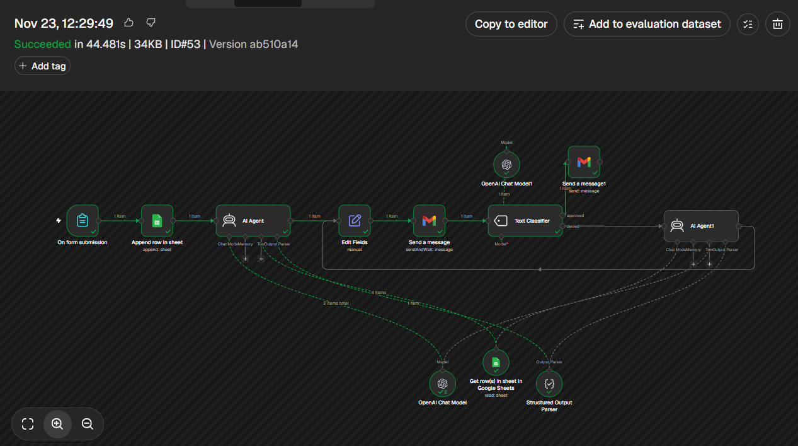
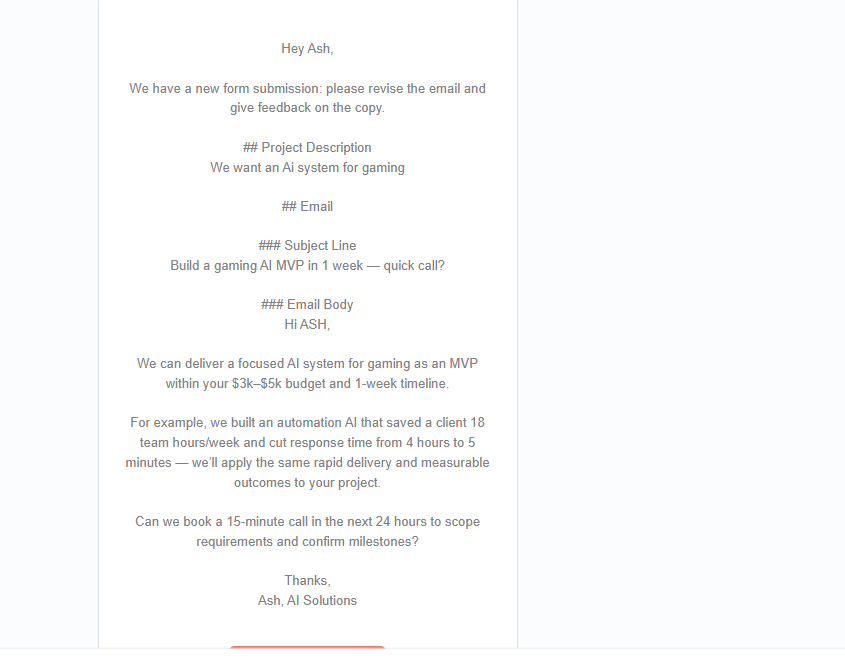
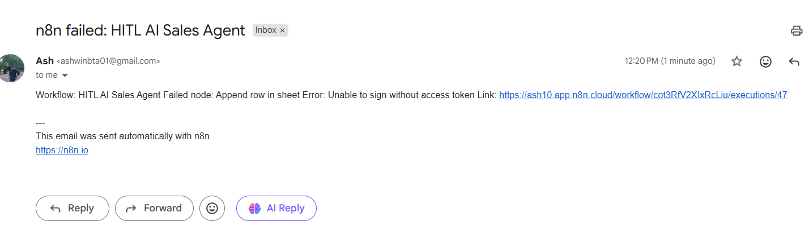

# HITL AI Sales Agent

A human-in-the-loop AI sales agent built in n8n. It turns form leads into personalized outreach emails and sends nothing until a human approves.

**Demo video:** [Watch the Loom walkthrough](ADD_LOOM_LINK_HERE)



## Problem

Replying to inbound leads by hand is slow, and fully automated AI replies are risky because one bad email can cost a deal. This workflow drafts a tailored reply in seconds, pulls in a relevant past project as proof, and keeps a person in control: the lead only gets an email after it has been approved, and rejected drafts are rewritten from the reviewer's feedback.

## How it works

1. **Lead intake.** A lead fills in an n8n form: name, email, company, budget, project description, timeline and intent.
2. **Log the lead.** The submission is appended to a Google Sheet.
3. **Draft the email.** An AI Agent (OpenAI chat model) writes a short sales email under 100 words. It uses a Google Sheets tool to look up similar past projects and cite one. A Structured Output Parser forces the reply into `{ subject, email_body }`.
4. **Human approval.** The reviewer receives an email with the draft and replies in free text (n8n's send-and-wait step).
5. **Classify the reply.** A Text Classifier labels the reply `approved` or `denied`.
6. **Send or revise.**
   - `approved`: the email is sent to the lead through Gmail.
   - `denied`: a second AI Agent rewrites the draft using the reviewer's feedback, and the new draft goes back to step 4.
7. **Error alerts.** A separate error workflow emails me if any run fails.



### Error handling

`workflows/global-error-alert.json` is an **Error Trigger** workflow connected to a Gmail node. It is set as the Error Workflow in the sales agent's settings. When a production run fails, it emails the workflow name, the failed node, the error message and a link to the execution.

I tested it by making real failures happen (an expired Google Sheets credential, and an AI output that didn't match the parser schema) and confirming that each one produced an alert.



## Tech stack

- n8n (Cloud)
- OpenAI chat models (drafting, classifying)
- Google Sheets (lead log and past-project lookup)
- Gmail (approval request, outreach, error alerts)

## Setup

1. **Import the workflows** into n8n (Workflows → Import from file):
   - `workflows/hitl-sales-agent.json`
   - `workflows/global-error-alert.json`
2. **Create credentials** and attach them to the matching nodes:
   - Google Sheets OAuth2
   - Gmail OAuth2
   - OpenAI API key
3. **Prepare the Google Sheet** with two tabs: one for leads (columns matching the form fields) and one for past projects (the agent searches this for examples). Point the Google Sheets nodes at your sheet.
4. **Replace the placeholder email** `you@example.com` in both Gmail nodes with your own address.
5. **Link the error workflow:** in the sales agent, open ⋯ → Settings → Error Workflow and select `Global Error Alert`.
6. **Publish both workflows.** Error workflows only fire on automatic runs, not manual test runs, so use the form's **Production URL** to submit leads.

## Repo structure

```
hitl-ai-sales-agent/
├── README.md
├── workflows/
│   ├── hitl-sales-agent.json
│   └── global-error-alert.json
└── screenshots/
```

## What I'd improve next

- Cap the number of revision rounds so a denied draft can't loop forever.
- Add retries with backoff on the AI and Gmail nodes, and handle partial failures.
- Make writes idempotent so a re-submitted form doesn't create duplicate rows or emails.
- Add a confidence or lead-scoring step so low-fit leads skip the draft stage.
- Sync approved leads to a CRM (HubSpot) and track reply and approval rates.

## Author

Aswin Kumar B. [GitHub](https://github.com/Ashxin) · [LinkedIn](https://linkedin.com/in/aswinkumar0b1)
